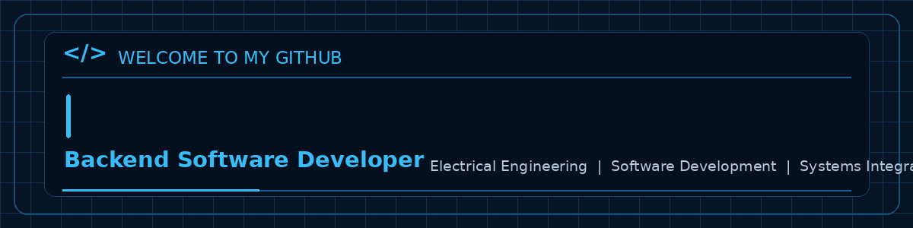

  

---

## About Me

I'm a backend-focused software developer with a National Diploma in Electrical Engineering and an interest in building practical software solutions for manufacturing, industrial operations and data-driven systems.

Currently developing my expertise in Java, Python, Spring Boot, database management and system integration.

### Areas of Interest

- Backend application development
- Manufacturing and industrial software
- Database engineering
- REST API development
- System integration

## Technical Skills

**Languages**
- Java
- Python
- SQL

**Frameworks & Technologies**
- Spring Boot
- PostgreSQL
- Docker
- Maven

**Tools & Testing**
- Git & GitHub
- JUnit 5
- Pytest
- IntelliJ IDEA
- VS Code

## Featured Projects

### HealthSafe Data Pipeline
A data pipeline project focused on data ingestion, cleaning, validation and PostgreSQL integration.

**Technologies:** Python, PostgreSQL, Docker, Pytest

[View Repository](YOUR_HEALTHSAFE_REPOSITORY_URL)

### Vehicle Manufacturing Management System
A backend-focused manufacturing management application currently in development.

**Technologies:** Java, Spring Boot

[View Repository](https://github.com/lebs-M/vehicle-manufacturing-management-system)

### Factory Inventory Backend
A backend application focused on inventory management and manufacturing operations, currently in development.

**Technologies:** Java, Spring Boot, PostgreSQL

[View Repository](https://github.com/lebs-M/factory-inventory-backend)

## Let's Connect

- GitHub: [@lebs-M](https://github.com/lebs-M)

---

  Building, learning and engineering better solutions.

