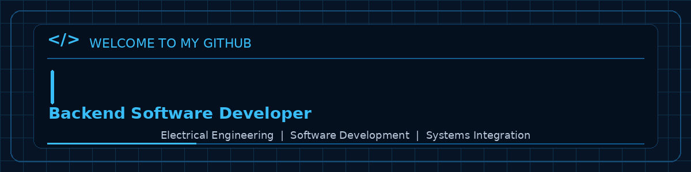
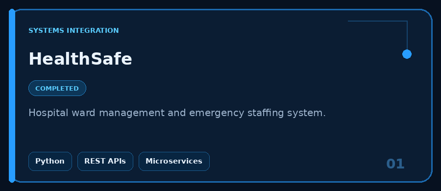
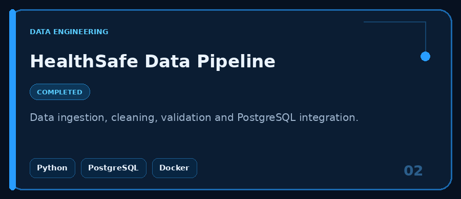
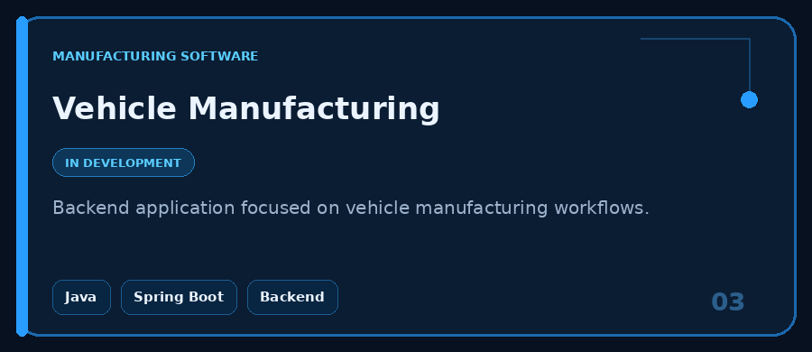
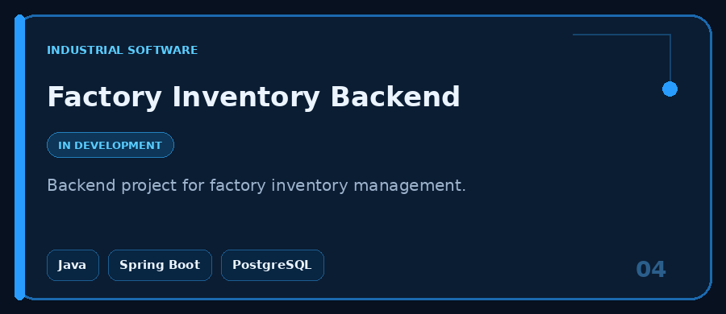

  

---

## About Me

I'm a backend-focused software developer with a National Diploma in Electrical Engineering and an interest in building practical software solutions for manufacturing, industrial operations and data-driven systems.

Currently developing my expertise in Java, Python, Spring Boot, database management and system integration.

### Areas of Interest

- Backend application development
- Manufacturing and industrial software
- Database engineering
- REST API development
- System integration

## 🛠️ Technical Skills

### Programming Languages

  
  
  

### Backend & Databases

  
  
  

### Tools & Testing

  
  
  
  
  

##  Featured Projects

<table>
  <tr>
    <td width="50%">
      
    </td>
    <td width="50%">
      
    </td>
  </tr>
  <tr>
    <td width="50%">
      
    </td>
    <td width="50%">
      
    </td>
  </tr>
</table>

### 🔗 More Projects

- [LogisticsConnect](https://github.com/lebs-M/sin-001-logisticsconnect) — Logistics systems integration
- [Pattern Generator](https://github.com/lebs-M/pattern-generator) — Python geometric pattern generator
- [ATM Simulator](https://github.com/lebs-M/atm-simulator) — Command-line banking application
- [OOP Fundamentals](https://github.com/lebs-M/oop-fundamentals) — Object-oriented programming practice

**Project Status:** HealthSafe – Systems Integration and HealthSafe Data Pipeline are completed. Vehicle Manufacturing and Factory Inventory are currently in development.

## 📊 GitHub Statistics

  
  

  

## Let's Connect

- GitHub: [@lebs-M](https://github.com/lebs-M)

---

  Building, learning and engineering better solutions.

